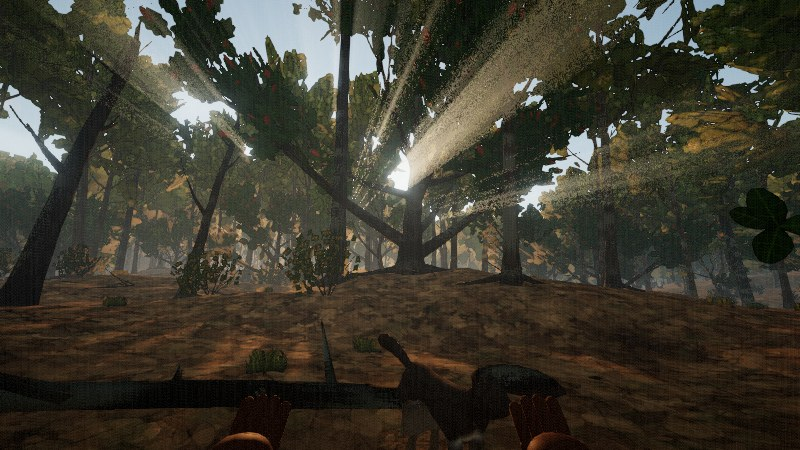
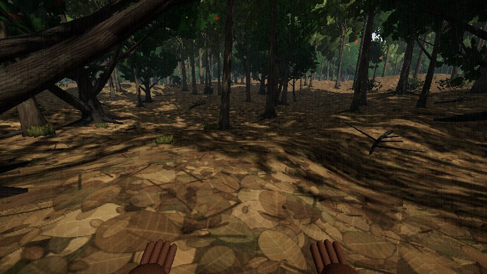
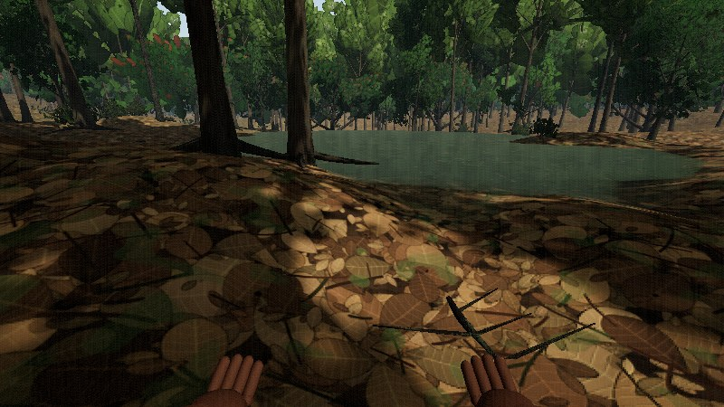
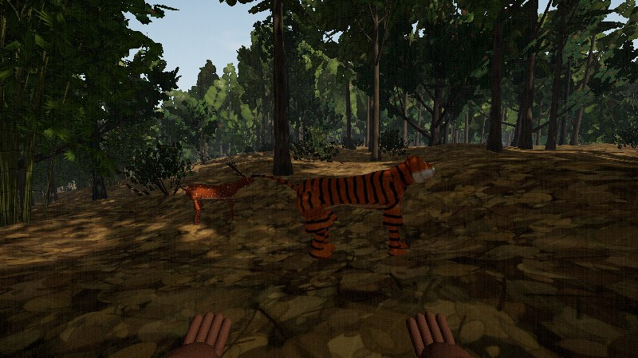
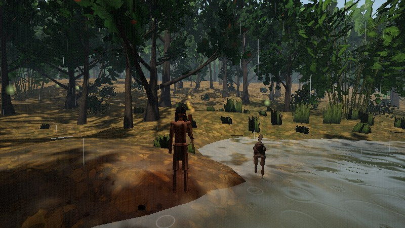
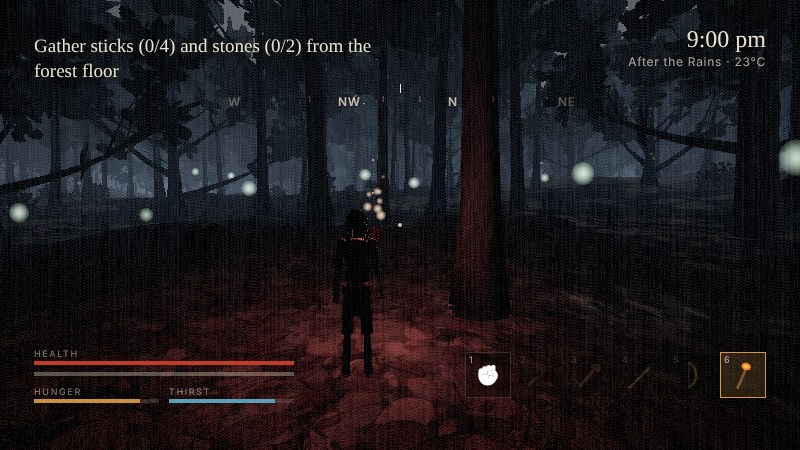

# VANAJ: Forest-Born

A third- and first-person survival game in the browser, set in **Pench Tiger Reserve** (Seoni, Madhya Pradesh), the real forest behind Kipling's Mowgli stories.

A boy who was lost in a flood at three has grown up alone in the jungle. He doesn't know whether anyone like him exists. Over four seasons he learns to survive, talks to and fights the animals around him, follows clues left by humans, and in the end walks into a Gond village and finds the grandmother who lost him.

Terrain, trees, ground cover, textures, sound and music are generated in code at load time. The player, villagers, deer, gaur, cattle, dogs and wild dogs use rigged, animated CC0 models (see Credits); the remaining animals are still built in code.








## Run it

ES modules need a web server; opening `index.html` straight from disk won't work.

```bash
python3 -m http.server 8000
# then open http://localhost:8000
```

Any static host works too (GitHub Pages, Netlify, etc.). Use a recent Chrome, Edge or Firefox with WebGL2. Headphones help: the sound is spatial.

URL options: `?q=low|medium|high|ultra` sets quality, `&pr=1` caps the pixel ratio, `&perf=compact|full` opens the performance overlay.

## Controls

| Key | Action |
|---|---|
| W A S D | Move |
| Shift | Sprint |
| C | Crouch (stealth) |
| Space | Jump; with block held, dodge |
| Left mouse | Attack; hold to draw the bow |
| Right mouse | Block; aim a spear throw |
| E | Use, pick up, drink, fish |
| Enter | Hurry a line of talk along |
| Q (hold) | Call wheel: hum, langur cough, roar, whistle, flute |
| V | Switch first / third person |
| 1–6 | Fists, knife, club, spear, bow, torch |
| T | Torch on/off |
| Tab | Pouch and crafting |
| J | Journal and lore |
| M | Map |
| H / B | Bind a wound / eat |
| Esc | Pause |
| F3 | Performance overlay: off → compact → full |

## The story

Written for everyone from children to adults: there is danger and one quiet loss, but nothing bleeds and the player kills nothing. An animal that loses a fight runs off.

13 chapters in four acts, one per season, and an epilogue:

- **Act I · Winter**: Fog on the Teak · The Langurs' Road · The Wire
- **Act II · Summer**: East · The Burning Months · Cut Wood · The Shadow on the Rocks
- **Act III · Monsoon**: First Rain · Chingari · The Old Flood
- **Act IV · After the Rains**: The Tower · The Flute · Torn-Ear
- **Epilogue**: The Name in the Steel

Vanaj understands animals, so they speak: each line shows who said it, the real call it was (a langur's cough-bark, a sambar's bell) and what it means to him. The opening plays in the world itself: the Pench in flood, then the sandbank at dawn.

At the end Torn-Ear, the old tiger, lies beaten with a snare wire in his leg. The player can work the wire loose or roar him out of the valley. The choice doesn't change the ending; it only shows who the player is.

Settings has two play styles: **Gentle** (blows land soft, hunger is slow, an animal can't knock you out) and **Adventure**.

## What's in it

- **World**: a 4 km × 4 km landscape built from the real place: the Pench river, a reservoir, waterholes, rocky ridges, open grassland, bamboo brakes, termite mounds and a village. It streams in 64 m chunks with distance-based detail.
- **Ground**: real objects lie on the forest floor near you, not just a painted texture: thousands of individual curled leaf meshes in drifts (teak, mahua, saja, palash, bamboo straw), forked sticks, stones (red laterite on the ridges, grey rock elsewhere) and rounded, algae-tinted cobbles on stream and pond beds under the water. The ground itself has small hummocks and hollows. Further out, the floor shader places individual leaves, twigs and pebbles one by one (no repeating tile), with damp litter, laterite, black soil, sheet rock, burn scars and puddles; under water it switches to silt and pebbles with moving caustics. Leaf cover follows the season: thick in summer, rotted away after the rains.
- **Plants**: teak, mahua, saja, kulu, palash, arjun, banyan, bamboo and lantana. Trees grow from a recursive branching model (adapted from EZ-Tree): trunks fork, bend, lean and taper, with roots, broken snags and dead limbs, and each species has its own growth habit. Teak, mahua, saja and palash use photo-scanned bark; every tree gets its own girth, lean and tint. Wind sway, seasonal leaf fall and flowering.
- **Water**: the light path through the water decides what you see: the bed shows in the shallows, deep pools go dark. The surrounding forest reflects in the surface. Seasons change the water: clear green winter pools, algae and floating leaves on stagnant summer pools, muddy ochre monsoon spate.
- **Light**: sun shafts through the canopy, dappled sun flecks on the forest floor, ground occlusion at tree bases and rocks, SMAA anti-aliasing (Medium) or MSAA with alpha-to-coverage foliage (High/Ultra).
- **Sky and weather**: the sun follows its real path at 21.7° N for each season. There are clouds, a moon and stars, height fog, haze, mist, rain, storms and lightning; streams and waterholes rise in the monsoon.
- **Animals**: tiger, leopard, dhole, wolf, sloth bear, gaur, sambar, chital, wild boar, grey langur, peafowl, mugger crocodile, village cows and dogs. Chital, sambar, gaur, dhole, wolf, dogs and cattle are rigged models with blended walk, gallop, graze, attack, hit-react and death clips. Behaviour follows the day rather than chance: grazing at dawn and dusk, resting in shade at midday, walking to water to drink. Chital follow langur troops; alarm calls spread between species, and sambar bell only for tiger, leopard or dhole. Herds, packs that circle their prey, ambushes from the water and a companion who follows you.
- **Birds**: flocks of spotted doves, mynas and rose-ringed parakeets feed on open ground, flush when you or a predator come near and settle further off, and stream to roost at dusk. Vultures gather and circle over a kill.
- **Real places**: the map uses real Pench names, shown as you walk in: Alikatta meadow, Junewani Talao (dead trees standing in the water), Piyorthadi rocks, Kalapahad, Sitaghat and Raiyakassa on the river, Jamun Nala, Chhindimatta, Karmajhiri, Turia and the Totladoh reservoir.
- **Tracking**: animals leave pugmarks, paw prints and hoof slots that fade over hours and wash out in rain. Crouch still over them to read who made them, how old they are and which way they went. Alarm calls are read out too, with the direction and what that caller only calls for.
- **Movement**: feet plant on uneven ground (two-bone leg IK with pelvis drop), the walk vaults over the stance leg while the run compresses into it, and the third-person camera won't pass through trunks or walls.
- **Survival and standing your ground**: hunger, thirst, sickness and fire. You craft a knife, club, spear, bow, arrows, torch and flute, catch fish at the water's edge and roast them. Fights are about nerve: block, dodge, roar, hold fire, and the animal backs down and runs. Animals remember how you treat their kind: hum to them crouched and unarmed and they let you closer; hit them and they bolt sooner.
- **Sound**: Web Audio with spatial (HRTF) panning and reverb. Birds, animal calls, footsteps for each surface, impacts and thunder are all synthesised.
- **Music**: models of real instruments, with no synth pads: bansuri flute, tanpura with its buzzing *jawari* bridge, the Pardhan *bana* fiddle, and the Baiga *mandar* drum, plus timki and manjira. Exploration music follows the raga cycle of the day (Bhairav at dawn through Malkauns past midnight, Megh in the monsoon). Fights switch to a Keherwa drum cycle.

## Performance overlay

Press **F3** (or pick it in Settings) to cycle Off → Compact → Full. The full view shows:

- **FPS and frame time**: current, average, 1% low and worst frame, with a frame-time graph marked at 60 and 30 FPS.
- **CPU**: main-thread milliseconds per frame, split by system (player, world streaming, sky/weather, animals/AI, effects, audio, HUD, render submission), and the share of each frame the main thread was busy.
- **GPU**: GPU milliseconds per frame from WebGL timer queries, with a CPU-bound / GPU-bound hint and the GPU's name. Shows n/a where the browser doesn't expose timer queries.
- **Draws**: draw calls and triangles across every pass (shadows, scene, bloom, grading), plus shader, geometry and texture counts.
- **RAM**: JavaScript heap used and limit (Chrome and Edge only) and the device memory the browser reports.
- **VRAM**: an estimate of GPU memory used by meshes, textures and render targets. Browsers don't report real GPU memory, so this is calculated from what the game has uploaded.

Browsers don't let a page read system-wide CPU or RAM usage, so those figures cover the game only.

## Code layout

About 10,000 lines of JavaScript on top of [three.js](https://threejs.org) r170 (MIT, bundled in `lib/`).

```
index.html            UI: menus, HUD, panels
js/main.js            boot, render pipeline, game loop, input, interactions, save/load
js/core/              noise, shared shader code (fog, wind), mesh merging, performance overlay
js/world/             terrain, flora, ground cover, birds, tracks, places, sky, weather, water, effects, props, textures
js/actors/            animals (AI, procedural and rigged bodies), rigged humans, player
assets/models/        rigged GLB models (CC0)
js/audio/             sound engine, music engine
js/game/              story engine (story.js), the chapters (chapters.js), dialogue, passing remarks, the opening, items, UI, lore
js/sim/               the director (world state, cast, standing with each species) and the animal mind (directives, shelter, trust)
```

## Credits

- [three.js](https://threejs.org) r170, MIT.
- Tree branching adapted from [EZ-Tree](https://github.com/dgreenheck/ez-tree) by Daniel Greenheck, MIT (`lib/textures/bark/EZ-TREE-LICENSE`).
- Bark scans: oak and willow from [Poly Haven](https://polyhaven.com) (CC0); pine and birch from TextureCan, as bundled with EZ-Tree. See `lib/textures/bark/SOURCES.md`.
- Animated animals (Ultimate Animated Animals) and the animated human mannequin: [Quaternius](https://quaternius.com), CC0 (`assets/models/LICENSE-Quaternius.txt`).

## Limitations

- Tiger, leopard, sloth bear, boar, langur, peafowl and crocodile are still procedural bodies animated in code; they look stylised up close until rigged models replace them.
- The rigged models are low-poly (Quaternius style).
- Pointer lock can be refused inside sandboxed frames. If the mouse doesn't lock, move the cursor to the screen edge to turn.
- Progress saves to your browser's localStorage.
